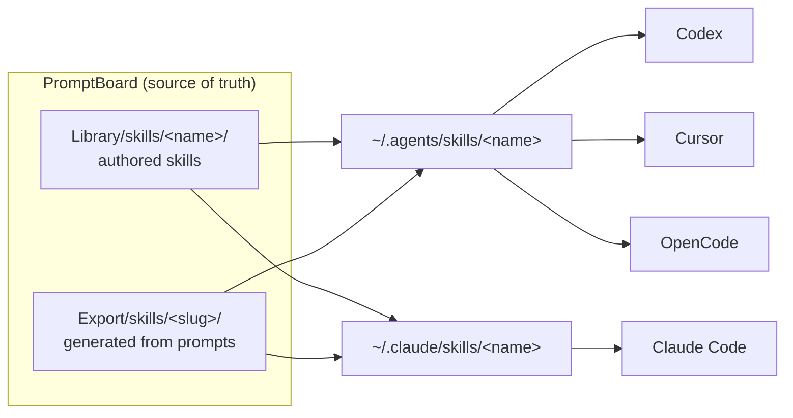

# Cross-Tool Sync — Design

**Date:** 2026-07-24
**Status:** Approved, ready for planning
**Layer:** E (follows A–D: library core, board redesign, skill editor, quick-insert)

## Context

PromptBoard manages prompts and skills but reaches only one tool. Today:

- **Skills** are symlinked into `~/.claude/skills` — Claude Code only.
- **Prompts** are stored as `<slug>.md` in the library and pushed **nowhere**. They are reachable only through the `promptboard` CLI and the MCP server, so they never appear as slash commands in any tool.

The user works across Claude Code, Codex, Cursor and OpenCode. Their real skills currently live scattered inside each tool's own config directory, siloed:

| Location | Items |
| --- | --- |
| `~/.claude/skills` | `ai-response-share`, `grill-me`, `request-ssh-terminal-session`, `summarize-my-work`, `trello-card-reader` |
| `~/.codex/skills` | `frontend-skill`, `vercel-deploy` |
| `~/.cursor/skills` | `g-phase-by-phase-plan` |
| `~/.agents/skills` | `caveman`, `compress`, `find-skills` |
| `~/.claude/commands` | `deslop.md`, `generate-analysis-fullstack-end-to-end.md`, `readability.md` |

The PromptBoard library holds 10 prompts and **zero** skills. So pushing the library alone would not unsilo anything — the design must also surface what already exists.

## Verified tool landscape

Researched against vendor docs and tool source (Codex's Rust skill loader, OpenCode's shipped binary), not training data. Two findings drove the architecture.

### Finding 1 — "commands" are being retired in favour of skills

- **Claude Code** — the slash-commands doc now redirects to skills; custom commands were merged into skills. Existing `~/.claude/commands/` files keep working, but on a name clash the **skill wins**.
- **Codex** — `~/.codex/prompts` was deprecated on 2026-01-22 and no prompt-loading code exists in current main. Treat as dead.
- **Cursor** — the commands doc page was removed and redirects to the skills migration guide. `~/.cursor/commands/` works but is undocumented.
- **OpenCode** — the only tool where commands remain healthy.

Skills are the convergent unit, and skills are user-invocable as `/name`. So a prompt rendered as a skill still yields `/code-review`.

### Finding 2 — two directories cover all four tools

`~/.agents/skills/` has become the cross-tool standard. Coverage:

| Target dir | Claude Code | Codex | Cursor | OpenCode |
| --- | --- | --- | --- | --- |
| `~/.agents/skills/` | no | yes (canonical) | yes | yes |
| `~/.claude/skills/` | yes | no | yes (compat) | yes |

Their union reaches every tool. Writing to eight per-tool directories is unnecessary.

### Directories that are off-limits

- `~/.codex/skills/.system/` — a cache Codex installs and wipes itself.
- `~/.cursor/skills-cursor/` — Cursor-managed; it reverts hand edits on sync.

PromptBoard never writes to either, and never lists their contents as adoptable.

## Locked decisions

1. **Targets** — write to `~/.agents/skills/` and `~/.claude/skills/`. Two dirs, all four tools.
2. **Direction** — push the library outward, **and** surface pre-existing external items read-only, with per-item adopt.
3. **Adopt** — prompts the user to choose **move** or **copy** each time.
4. **Representation** — skills are the universal unit. Prompts render as minimal skill folders.

## Architecture



Every entry created in a target directory is a **symlink** back into PromptBoard's own storage. Nothing is copied.

This matters: because the target entries are symlinks, editing a skill's files propagates to all four tools **immediately, with no sync step and no possibility of drift**. Only create, rename and delete require link work. Prompt-derived `SKILL.md` files are the one generated artefact, regenerated when the prompt changes.

## Storage layout

```
~/Library/Application Support/PromptBoard/
  Library/
    prompts/<slug>.md          unchanged — source of truth for prompts
    skills/<name>/             unchanged — source of truth for authored skills
  Export/
    skills/<slug>/SKILL.md     NEW — generated, one per prompt
    skills/<slug>/agents/openai.yaml   NEW — Codex invocation policy
```

`Export/` is wholly owned and regenerated by PromptBoard. It is kept separate from `Library/` so that a prompt does not appear twice in the board, and so the library remains the clean hand-authored surface.

## Rendering a prompt as a skill

For prompt `Code Review` with slug `code-review`, write `Export/skills/code-review/SKILL.md`:

```yaml
---
name: code-review
description: Code Review. Saved PromptBoard prompt, user-invoked only.
disable-model-invocation: true
---

<prompt body, verbatim>
```

Field rules, driven by what each tool actually enforces:

- `name` — always emitted, equal to the folder name. OpenCode silently skips a skill with no `name`; Cursor requires it to match the parent folder.
- `description` — always emitted, never empty. Codex raises `MissingField("description")` on an empty value. Capped at 1024 characters to satisfy Codex's limit. Derived as `"<Title>. Saved PromptBoard prompt, user-invoked only."` — deliberately dull so it does not read as an auto-invocation trigger.
- `disable-model-invocation: true` — honoured by Claude Code and Cursor.
- The prompt body is copied verbatim, with the PromptBoard frontmatter (`id`, `createdAt`, `updatedAt`, `title`, `group`) stripped.

Alongside it, `Export/skills/<slug>/agents/openai.yaml` carries Codex's equivalent opt-out:

```yaml
policy:
  allow_implicit_invocation: false
```

Unknown frontmatter keys are ignored by Codex (serde, no `deny_unknown_fields`) and by OpenCode (Zod strips them), so the shared file is safe across tools.

**Accepted limitation:** OpenCode has no model-invocation opt-out, so a prompt-derived skill may occasionally be auto-invoked there.

## Ownership rule

There is **no manifest file**. Ownership is derived, which removes a class of drift and corruption bugs:

> An entry in a target directory belongs to PromptBoard if and only if it is a symlink whose resolved target lies inside `~/Library/Application Support/PromptBoard/`.

Everything else — real directories, symlinks pointing elsewhere — is external and is never modified. This reuses the `expectedTarget` check already present in `SymlinkManager`, and it is what lets the external scanner avoid re-reporting PromptBoard's own writes as external items.

## External discovery

Scanned read-only on launch and on refresh:

| Origin badge | Paths scanned |
| --- | --- |
| Claude Code | `~/.claude/skills`, `~/.claude/commands` |
| Agents (shared) | `~/.agents/skills` |
| Codex | `~/.codex/skills` |
| Cursor | `~/.cursor/skills` |
| OpenCode | `~/.config/opencode/{skill,skills,command,commands}` |

OpenCode's singular and plural directory names are both scanned because its loader globs `{command,commands}` and `{skill,skills}`.

Skipped unconditionally: `~/.codex/skills/.system/`, `~/.cursor/skills-cursor/`, any entry whose name begins with `.`, and any entry owned by PromptBoard per the ownership rule.

A directory containing `SKILL.md` is surfaced as an external skill; a top-level `.md` file in a commands directory is surfaced as an external prompt. External items are read-only in the board and carry an origin badge.

## Adopt

Adopting an external item opens a dialog with two choices.

**Move** — the item's content is copied into `Library/` (as a skill folder, or as a prompt for a commands `.md`), the original is backed up to `<original>.promptboard-backup-<timestamp>`, the original is deleted, and a managed symlink is created **at the original path**. That in-place link means the origin tool keeps working even if it reads only its own directory — relevant for an item adopted out of `~/.cursor/skills`, which is not one of the two target dirs. Normal reconcile then additionally links the item into both target dirs, so it reaches all four tools. Editing it in PromptBoard updates everywhere.

The in-place link is classified as PromptBoard-owned by the ownership rule below, so the scanner will not re-report the adopted item as external.

**Copy** — the content is copied into `Library/` and the original is left completely untouched. The origin tool keeps reading its own file; PromptBoard's copy serves the other tools. The two can drift, which is the explicit cost of this choice.

After either, the adopted item is a normal library item and the external entry disappears from the board (move) or remains listed as external (copy).

## Collisions and no-clobber

The existing strict rule extends unchanged to both target directories: **PromptBoard only ever removes or replaces a path it created.** Anything else at a target path is left alone.

Two collision cases and their handling:

1. **Target path already occupied by a foreign entry** — for example a library skill named `caveman` when `~/.agents/skills/caveman` already exists and is not ours. The link is not created, and the item's card shows a **conflict badge** naming the blocking path. Nothing is overwritten and nothing fails silently.
2. **A prompt's slug equals an authored skill's folder name** — the authored skill wins. The prompt's export is skipped and the prompt card shows a conflict badge prompting a rename. Auto-suffixing is deliberately rejected: silently changing the slash-command name a user types is worse than telling them.

## Rename and delete propagation

Renaming a library skill unlinks the old name from both target dirs (guarded by `expectedTarget`), moves the library folder, then links the new name into both. Deleting unlinks from both and removes the source. Deleting a prompt also removes its `Export/skills/<slug>/` folder. All operations are idempotent and no-clobber.

## Sync triggers

- **On launch** — full reconcile: regenerate `Export/`, then ensure links in both target dirs match the library exactly.
- **On library change** — the existing `DirectoryChangeWatcher` fires; the reconcile is debounced at 150 ms, matching the current reload path.
- **No manual sync button** in v1. Because targets are symlinks, content is always current; only structural changes need work, and those are already observed.

## UI changes

- External items render as cards with an **origin badge** and a muted treatment, marked read-only.
- A **Show external** toggle in the sidebar, on by default, so the board can be filtered back to just the library.
- An **Adopt into library** action on external cards, opening the move/copy dialog.
- A **conflict badge** on any item whose link was refused, with the blocking path in its tooltip.
- Quick-insert (`⌥/`) continues to offer **library prompts only**. External items are not insertable, keeping the popup's ranking behaviour unchanged.

## Components

**Kit** (`Sources/PromptBoardKit/`)

- `SymlinkManager` — extended from one directory to a set of target directories.
- `SkillExportRenderer` (new) — pure function: `Prompt` → `SKILL.md` text + `openai.yaml` text. Fully unit-testable, no filesystem.
- `ExternalLibraryScanner` (new) — scans the configured roots, applies skip rules and the ownership rule, returns badged external entries.
- `SyncReconciler` (new) — computes and applies the link set for both target dirs; idempotent; reports conflicts.
- `LibraryRepository` — gains `adoptExternal(item:mode:)` plus export regeneration hooks on prompt create/update/delete.

**App** (`Sources/PromptBoardApp/`)

- External card rendering, origin badges, conflict badges, the show-external toggle, and the adopt dialog.

## Testing

- **Unit** — `SkillExportRenderer` output (required keys present, `name` matches folder, description non-empty and within 1024 chars, PromptBoard frontmatter stripped, body verbatim); ownership classification; scanner skip rules covering `.system`, `skills-cursor` and dot-entries; both collision cases.
- **Behavioural** — adopt-move (backup created, original replaced by symlink, item reaches both targets) and adopt-copy (original byte-identical afterwards); rename and delete propagation across both target dirs; reconcile idempotency across repeated runs.
- **Smoke** — real link creation in both dirs, then run `claude`, `cursor-agent` and `opencode` and confirm each lists a synced item. This also settles the Cursor symlink question below.

**Test isolation is mandatory.** Every test must override both target directories and all scan roots to temp paths. Layer C leaked four dangling symlinks into the real `~/.claude/skills` by relying on default paths; that must not recur. Environment overrides: the existing `PROMPTBOARD_CLAUDE_SKILLS_DIR`, plus new `PROMPTBOARD_AGENTS_SKILLS_DIR` and `PROMPTBOARD_EXTERNAL_SCAN_ROOTS`. The first two take a single absolute path each. `PROMPTBOARD_EXTERNAL_SCAN_ROOTS` takes a colon-separated list of absolute paths which **replaces** the built-in scan table entirely; when it is set, every scanned root carries the origin badge `External`, since the built-in path-to-badge mapping no longer applies.

## Risks

| Risk | Mitigation |
| --- | --- |
| Cursor's CLI resolves symlinks unreliably (IDE is fine) | Verified empirically in the smoke test with the installed `cursor-agent`. If links are not seen, add a real-copy mirror into `~/.cursor/skills/` for Cursor only. Not built speculatively. |
| OpenCode may auto-invoke a prompt-derived skill | Accepted and documented. No opt-out exists in OpenCode. |
| Adopt-move deletes a user file | Timestamped backup written before removal; move is never the silent default — the dialog asks every time. |
| A tool changes its skill directory convention | Target dirs are configurable via environment overrides, and the ownership rule is path-independent. |
| Codex reads the deprecated `~/.codex/skills` | We scan it for external items but never write there. New writes go to the canonical `~/.agents/skills`. |

## Non-goals

Project-level sync (writing into a repo's `.claude/` or `.cursor/` so teammates inherit prompts); two-way live sync of external items edited in place; per-tool enable/disable toggles; writing to any tool's commands or prompts directory; managing Codex `.system` or Cursor `skills-cursor` content; git-backed or cloud backup of the library.
